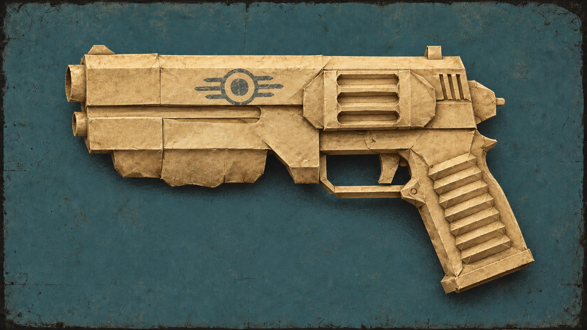

# PAPER - Propper Active Precision Engineered Reloads

[](LICENSE)

> A Fallout 4 VR F4SE plugin that brings back reload and weapon-cycling animations: your arms, hands and fingers follow the weapon's own animation while ROCK keeps the weapon in your hand. Other mods read its reload data and take over reloads through its provider API.

[Download on Nexus Mods](https://www.nexusmods.com/fallout4/mods/108883) · [API reference](docs/api/Provider.md) · [Developer guide](https://devartificial.pro/docs/apis/paper) · [Changelog](CHANGELOG.md)

<p align="center">
  
</p>

## Table of Contents

- [Background](#background)
- [Install](#install)
- [Configuration](#configuration)
- [Building mods with PAPER](#building-mods-with-paper)
- [Building PAPER from source](#building-paper-from-source)
- [License](#license)

## Background

Fallout 4 VR does not show reload and weapon-cycling animations on the player's hands. PAPER restores them: it plays the weapon's native animation and moves the arms, hands and fingers with it, while ROCK keeps the weapon following your controller. It runs as an F4SE plugin (`PAPER.dll`) on top of [ROCK](https://github.com/brunocatani/ROCK).

What it provides:

- **Animated reloads** - the player's hands follow the weapon's reload sequence.
- **Weapon cycling** - bolt actions, lever actions and revolver hammer cocking.
- **Controller-directed handling** - the weapon stays in your hand while the hands animate around it.
- **Optional manual reloads** - turn off automatic reloads when the magazine runs empty.
- **Bolt hold-open** - an empty gun's bolt or slide stays open until you reload, in either hand, at the position the gun's own animations show.
- **Round in the chamber** - optional: a gun that fires cartridges keeps a round in the chamber through a reload, shows it on the ammo counter, and keeps its rounds when you unequip it and in your saves.
- **Hand-worked bolts** - optional: work the bolt of a bolt-action rifle with your hand after each shot, and leave it open if you want.
- **Live settings** - TOML settings that reload while the game runs, with in-game pages in RobCo PALM.
- **Provider API** - 2 interfaces: runtime, animation and hand-pose data for other mods, and a lease that hands a reload to a mod that drives it with the player's hands.

PAPER is part of the RPS suite and builds on [ROCK](https://github.com/brunocatani/ROCK). Mods that make reloads physical take over from PAPER through its PhysicalReload interface.

## Install

### Requirements

- Fallout 4 VR `1.2.72.0` and [F4SEVR](https://f4se.silverlock.org/).
- [VR Address Library for F4SEVR](https://www.nexusmods.com/fallout4/mods/64879).
- [ROCK](https://www.nexusmods.com/fallout4/mods/108881) 1.0 with its requirements, including [FRIK](https://www.nexusmods.com/fallout4/mods/53464) 0.79.1 or newer with FRIK API 2.3. PAPER binds ROCK's provider API 2.0; if ROCK is missing or older, PAPER logs why and animates nothing.
- Optional: [RPS UI Framework](https://www.nexusmods.com/fallout4/mods/108951), only for PAPER's diagnostic drawing.

The PAPER 1.2 download on Nexus Mods is built for ROCK 0.92. This README describes current source.

### Recommended install

Install the archive from [Nexus Mods](https://www.nexusmods.com/fallout4/mods/108883) or the `.7z` asset on [GitHub Releases](https://github.com/brunocatani/PAPER/releases/latest) with your mod manager. `PAPER.dll` goes to `Data/F4SE/Plugins`. GitHub's automatic source archives are for development.

### Compatibility

- **Animations** - custom animation replacers for vanilla weapons are recommended. Results depend on each weapon's animation files and how well they work in VR; some are already broken in VR.
- **Virtual Reloads** is incompatible, as listed on the [Nexus page](https://www.nexusmods.com/fallout4/mods/108883).
- **Tactical Reload** - PAPER coordinates with it when `TacticalReload.esm` is loaded.
- **Merged Root Behavior** - when the merged behavior graph has no reserve reload animation for the equipped weapon, PAPER plays that graph's normal reload instead, with the game's own timing and ammo count.
- **Weapons with a FRIK weapon offset** - when ROCK seats a weapon from your FRIK weapon offset, PAPER leaves its reloads and cycles to the game.
- **Mods built against PAPER's pre-2.0 API** (`PAPERApi.h`) stop the game: at the main menu an error box names each one, and the game closes when the box is closed. Update or remove them; they work again once rebuilt against the headers in [include/PAPER/](include/PAPER/).
- **An older ROCK** stops the game the same way: PAPER needs the ROCK it was built for, and the error box says so.

## Configuration

PAPER reads one file under your Windows Documents folder:

```text
My Games/Fallout4VR/Mods_Config/PAPER/PAPER.toml
```

PAPER creates the file from its compiled defaults when it is missing, and at every start adds options a new version brings, with their defaults. Each option has its help above it as `##` lines, which PAPER rewrites; your own notes on single-`#` lines above an option stay with it. An option PAPER no longer reads moves to a commented block at the end of the file. A value of the wrong type is logged with its line and that option keeps its last value. The file reloads while the game runs. RobCo PALM's PAPER page edits it in game.

Upgrading from a PAPER that used `PAPER.ini`: the first start carries every option you changed into `PAPER.toml` and deletes `PAPER.ini` once `PAPER.toml` is written and read back. Nothing to do by hand.

| Setting | Default | Purpose |
| --- | --- | --- |
| `[Main] Enabled` | `true` | Reload coordination and the manual-reload-only option. |
| `[Main] LogLevel` | `2` | Log level; 2 is normal information logging. |
| `[Reload] ManualReloadOnly` | `true` | `true` stops automatic reloads when ammunition runs out. Manual reload input still works. |
| `[Reload] HandBlendSeconds` | `0.15` | Seconds the left hand takes to move onto a reload, pump stroke or cycle animation, and back when it ends. `0` moves it instantly. |
| `[Reload] BoltHoldOpen` | `true` | `true` leaves an empty gun's bolt or slide open, in either hand, until a reload starts or rounds arrive. It needs a bolt on the game's `WeaponBolt` bone, and a gun none of whose animations open its bolt never holds. Bolt, lever, pump and double-barrel guns and revolvers never hold. |
| `[Reload] BoltHoldCloseSeconds` | `0.15` | Seconds the open bolt takes to return to the animation when a reload starts. `0` moves it instantly. |
| `[Reload] ChamberRound` | `true` | `true` keeps a round in the chamber of every gun that fires cartridges, in either hand. A round in the chamber when you reload stays on top of the full magazine, as far as your reserve goes, except on revolvers, double-barrels and miniguns. Each gun keeps its rounds and chamber when you unequip it and in your saves, unless it sits in a stack of identical guns. The ammo counter shows a cartridge for the chamber. Energy weapons, the Gauss rifle and launchers are left alone. |
| `[Reload] BoltAppreciation` | `false` | `true` makes you work the bolt of a bolt-action rifle by hand after each shot, with its own chamber whatever `ChamberRound` says. Lever guns, pumps and revolvers are not affected. |
| `[Reload] BoltPullDistance` | `7.0` | Game units of a full bolt pull, the same on every rifle. Moving your hand past half of it takes the bolt all the way. |
| `[Reload] BoltHandFromAnimation` | `true` | `true` lets the hand the rifle's cycle animation uses take the bolt the moment the rifle is drawn. `false` makes both hands wait for the weapon's collision. |
| `[Debug] DebugDrawNativeAnimation` | `false` | Draws PAPER's animation targets for diagnosis (needs RPS UI Framework). |

[PAPER_example.toml](data/config/PAPER_example.toml) documents every option. It is a reference only, never a file to install.

The log is `Documents/My Games/Fallout4VR/F4SE/PAPER.log`. When reporting an animation problem, include the weapon, the animation replacer you use, the action that failed and the log from that game session.

## Building mods with PAPER

PAPER publishes **provider API 2.0**: 2 interfaces your F4SE plugin discovers at runtime from `PAPER.dll`. The headers are in [include/PAPER/](include/PAPER/); take them from the release tag you ship against. They need only the C++20 standard library, and there is nothing to link.

### Set up

Point a CMake cache variable at PAPER's `include` directory:

```cmake
set(PAPER_INCLUDE_DIR "" CACHE PATH "PAPER include directory (the folder that contains PAPER/)")
target_include_directories(MyPlugin PRIVATE "${PAPER_INCLUDE_DIR}")
```

### Connect

```cpp
#include <PAPER/Client.h>
#include <PAPER/PhysicalReload.h>

paper::api::Client paper;
const paper::api::physical_reload::Api* reload{};

// Game thread, once game data is loaded.
void connectPaper() {
    auto* module = GetModuleHandleW(L"PAPER.dll");
    if (!module) return;  // PAPER absent: run without it
    auto query = reinterpret_cast<paper::api::QueryInterfaceV1>(
        GetProcAddress(module, paper::api::kQueryExportName));
    constexpr auto capabilities =
        static_cast<std::uint32_t>(paper::api::ConsumerCapability::RuntimeState) |
        static_cast<std::uint32_t>(paper::api::ConsumerCapability::AnimationAuthority);
    if (!query || paper.connect(query, "My Mod", capabilities) != paper::api::Status::Ok) return;
    paper.acquire(reload);
}

// Each frame your mod's hands drive the reload:
paper::api::physical_reload::Request request{};
request.weaponFormId = equippedFormId;
request.observedFrame = rockFrameIndex;  // the ROCK frame your hands acted on
if (reload) reload->acquire(paper.owner(), &request);
```

Call `paper.close()` on the game thread before your plugin's callback data goes away. [tests/ConsumerExample.cpp](tests/ConsumerExample.cpp) is a complete minimal consumer, compiled by PAPER's tests.

### Interfaces

| Interface | Use it to |
| --- | --- |
| [Provider](docs/api/Provider.md) | Register your mod; read runtime state, captured hand poses and the native pose pipeline; get a callback every frame; coordinate native animation. |
| [PhysicalReload](docs/api/PhysicalReload.md) | Take a reload or manual cycle away from PAPER's animation while your mod drives it with the player's hands. |

### Rules every consumer follows

- One owner per mod, named after the mod. Request only the capabilities you use and check they were granted.
- Value-initialize every record (`{}`); PAPER checks each record's `size` and `version`.
- Every call except discovery, `getModVersion` and `isReady` runs on the game thread.
- Leases (physical reload, timed animation authority) last a set number of frames: renew them while you need them.
- Copied state carries generations and sequences: drop cached data when they change, and restart a paged copy on `StaleSnapshot`.

Start with the [Provider page](docs/api/Provider.md), then the [PhysicalReload page](docs/api/PhysicalReload.md) if you drive reloads. The [developer guide](https://devartificial.pro/docs/apis/paper) adds a first consumer, recipes and a table of where the pre-2.0 API moved.

## Building PAPER from source

### Prerequisites

- Windows x64 with Visual Studio 2022 (v143 toolset and a Windows SDK), x64 only, with Desktop development with C++
  - `winget install -e --id Microsoft.VisualStudio.2022.Community --override "--passive --wait --add Microsoft.VisualStudio.Workload.NativeDesktop --includeRecommended --norestart"`
- CMake 4.2 or newer
  - `winget install -e --id Kitware.CMake`
- [vcpkg](https://github.com/microsoft/vcpkg), with the `VCPKG_ROOT` environment variable pointing to it
  - `git clone https://github.com/microsoft/vcpkg.git`, run `bootstrap-vcpkg.bat`, then `setx VCPKG_ROOT "<path to vcpkg>"`
- A [CommonLibF4VR](https://github.com/ArthurHub/CommonLibF4VR) checkout. PAPER links it directly.
- [ROCK](https://github.com/brunocatani/ROCK) and [RPS UI Framework](https://github.com/brunocatani/RPS_UI_Framework) checkouts. PAPER compiles against the `include/` headers of both.
- An [RPS Framework](https://github.com/brunocatani/RPS_Framework) checkout, built first with its own `custom-fast` preset, which stages the package PAPER links for its settings file.

PAPER uses C++23. vcpkg installs the other libraries from `vcpkg.json`.

### Build

Copy [CMakeUserPresets.json.template](CMakeUserPresets.json.template) to `CMakeUserPresets.json`, replace its example vcpkg paths with yours, and set:

- `COMMON_LIB_F4VR_PATH` to your CommonLibF4VR checkout;
- `COPY_PLUGIN_BASE_PATH` to the mod folder the build copies `PAPER.dll` and `PAPER.pdb` into (an MO2 mod folder or the game's `Data` folder);
- `ROCK_INCLUDE_DIR` (ROCK's `include` directory), `RPSUI_INCLUDE_DIR` (RPS UI's `include` directory) and `RPSFramework_DIR` (`build-fast/stage/lib/cmake/RPSFramework` in RPS Framework) when your checkouts are not where [CMakeLists.txt](CMakeLists.txt) looks by default.

Then, from the repository root:

```powershell
cmake --preset custom-fast
cmake --build build-fast --config Release --target PAPER
```

### Tests

Tests share `build-fast` but are built only on request:

```powershell
cmake --build build-fast --config Release --target build_tests
ctest --test-dir build-fast -C Release --output-on-failure
```

They cover the public headers (each compiled on its own, plus the consumer example), discovery, the API layout, configuration files, reload policy, attachment bindings and the physical-reload lease.

### Release package

Add a `custom-release` preset to `CMakeUserPresets.json` (the template has one), then:

```powershell
cmake --preset custom-release
cmake --build build-release --config Release --target PAPER
```

This writes a release's two files to `build-release/package`: a `.zip` that installs as it is, holding only `F4SE/Plugins/PAPER.dll`, and this readme beside it. It publishes nothing.

### Source layout

| Path | Contents |
| --- | --- |
| [include/PAPER](include/PAPER/) | Public provider API headers |
| [docs/api](docs/api/) | One page per provider interface |
| [src/PaperMain.cpp](src/PaperMain.cpp) | Plugin initialization and lifecycle |
| [src/animation](src/animation/) | Native animation authority and the hand pose pipeline |
| [src/reload_control](src/reload_control/) | Manual-reload-only control, the empty-gun bolt hold and the physical-reload lease |
| [src/animation_evidence](src/animation_evidence/) | The off-screen clip reader behind the bolt hold and the hand-action trace |
| [src/weapon_classification](src/weapon_classification/) | Weapon family classification |
| [src/api](src/api/) | Provider interface implementations and the ROCK client |
| [tests](tests/) | Tests and the consumer example |
| [cmake](cmake/) | Version resource and release packaging |

## License

[GNU GPL v3 only (GPL-3.0-only)](LICENSE).

Built with the assistance of AI.
